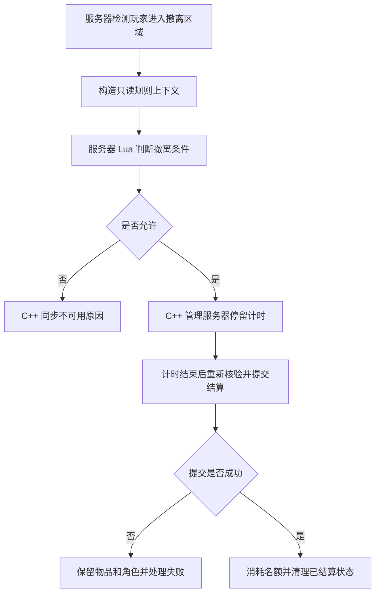

# BrokenEdge 搜打撤模式 Lua 接入与模块分工方案

日期：2026-11-09  
状态：架构建议，尚未实施 Lua 接入或代码迁移。

## 1. 结论与适用范围

项目没有必须改用 Lua 的模块。若目标是缩短界面和玩法规则的修改周期，建议采用 C++ 提供基础能力、Lua 编排界面与规则、配置资产保存数据的组合，按职责逐步拆分，不把现有 `.cpp` 文件整体翻译成 Lua。

优先试点物品详情、右键菜单或任务界面；其次考虑任务进度、撤离条件、地图事件和技能阶段。弹道、碰撞、移动、网络同步与存档提交继续保留在 C++。

本文结合当前源码及[《复刻三角洲行动的需求2》](../../Docs/复刻三角洲行动的需求2.txt)提出分工方案。需求编号用于追踪用户提出的问题，不表示这些问题目前仍未解决。本文不执行需求文件中历史的定时开发、提交或推送指令，也不修改该需求原文。

## 2. Lua 能带来什么，不能自动解决什么

Lua 适合表达频繁变化的交互和流程，修改脚本逻辑通常不需要重新编译 C++。通过 UnLua、slua-unreal 等接入层，可以调用暴露的 C++ 接口、绑定事件或实现部分蓝图事件。

引入 Lua 并不会自动解决组件职责混杂、库存规则不一致、碰撞不准确或动画资源错误。跨语言调用、对象生命周期、调试、脚本打包与版本管理也会增加维护成本。

Lua 脚本可以运行在客户端，也可以运行在服务器。服务器上的 Lua 可以执行权威规则；客户端脚本的判断不能代替服务器验证。可信度由执行位置和验证流程决定，不由 C++ 或 Lua 的语言名称决定。

脚本修改不需要 C++ 编译，也不等于已经具备线上热更新。脚本分发、版本兼容、加载时机和运行中状态迁移需要另行设计，首期不以线上热更新为目标。

## 3. 当前项目中需要保留的事实

### 3.1 GameMode 同时承担规则调度与生命周期管理

当前 [ExtractionGameMode.cpp](../../Source/BrokenEdge/Extraction/ExtractionGameMode.cpp) 中：

- `InitGame`、`BeginPlay` 准备地图、出生和撤离配置。
- `Tick` 协调等待、活动、结束阶段，并核验出战记录与加载状态。
- `UpdateExtraction` 检查撤离区域、开放条件、丢包要求和停留倒计时。
- `SettlePlayer` 提交物品及进度结算；调用方只有在提交成功后才清理物品和角色。
- `FinishRound`、`Logout` 等处理结束、断线和会话生命周期。

这些职责可以拆分，但必须保留现有的结算顺序与失败处理，不能只迁移正常流程。

### 3.2 普通枪械已有飞行弹丸实现

当前 [HitScanWeapon.cpp](../../Source/BrokenEdge/Weapon/HitScanWeapon.cpp) 会在搜打撤模式找到对应 `WeaponMechanics` 配置时生成 `AExtractionBullet`。当前配置文件包含 AK、M4A1、SCARH；找不到配置时，该入口保留旧射线命中分支。

[ExtractionBullet.cpp](../../Source/BrokenEdge/Weapon/ExtractionBullet.cpp) 使用固定模拟步长推进飞行，沿路径进行球形扫掠，并由服务器结算伤害。此类持续计算不作为首批 Lua 迁移对象。

注意：`UseImmediateServerHitScan()` 目前只关闭旧倒带开关；不能仅凭函数名或 `AHitScanWeapon` 类名判定最终采用即时射线命中。

### 3.3 不把方案当成已接入状态

本次检查的 `BrokenEdge.uproject` 插件列表未显式启用 UnLua 或 slua-unreal。这不等同于完成了所有引擎插件与依赖审计。本文没有验证 Lua 插件在当前 UE 5.8.3 环境中的编译、打包或运行兼容性。

## 4. 建议的模块分工

| 模块 | Lua 适合承担的职责 | C++ 建议保留的职责 | 迁移优先级 |
|---|---|---|---|
| `LootingMainView`、仓库界面 | 筛选、物品详情、右键菜单、拖拽交互流程、等待和错误提示 | 库存请求接口、最终合法性校验、物品移动与同步 | 高，先选小功能 |
| 改枪界面 | 配件列表、兼容性展示、属性对比、确认流程 | 最终装配校验、武器属性计算和应用接口 | 中 |
| `ExtractionProgression` | 任务条件、进度规则、奖励规则 | 进度持久化、防重复领奖和提交接口 | 中 |
| `ExtractionGameMode` | 对局规则、撤离条件、地图事件、刷怪策略 | 会话与角色生命周期、复制状态、出战验证、结算执行 | 中，先拆接口 |
| `ExtractionAbilities` | 技能前置条件、阶段顺序、效果组合和表现通知 | 投射物、碰撞查询、效果执行、服务器请求接口 | 中 |
| 守卫 AI | 增援条件、目标选择策略、任务阶段切换 | 感知与导航查询、移动执行、射击基础能力 | 低，不重复已有行为树职责 |
| `ExtractionBullet`、战斗组件 | 首期不迁移；可读取统一配置 | 飞行、扫掠、穿透、射速与请求校验、权威伤害入口 | 保留 C++ |
| 移动、攀爬、游泳 | 提示与交互流程可独立脚本化 | 移动模式、碰撞、网络预测、动画驱动接口 | 保留 C++ 核心 |
| `ExtractionPersistence`、库存数据层 | 调用明确的业务接口、呈现结果 | 存档写入、失败恢复、防重复结算、数据一致性 | 保留 C++ 核心 |

这是工程上的建议边界，不是 Lua 的能力上限。遇到高频逐对象调用，应测量脚本执行及跨语言调用成本，再决定迁移范围。

## 5. ExtractionGameMode 的具体拆分

### 5.1 保留一个负责执行的 C++ GameMode

保留 `AExtractionGameMode` 作为 UE 生命周期入口。它负责检查玩家与世界状态、调用规则、执行合法状态转换，并把需要客户端显示的数据写入 GameState/PlayerState。

不允许 Lua 规则随意跳过结算步骤直接销毁 Pawn 或清空库存。相关动作通过有明确前置条件和返回结果的接口执行。

### 5.2 将撤离条件提取为服务器规则



可放到 Lua 的条件例子：

- 撤离点是否到达开放时间。
- 是否要求丢弃背包。
- 是否完成拉闸或地图任务。
- 是否持有指定任务物品。
- 某个对局事件是否临时关闭此撤离点。

规则输入使用服务器生成的数据，例如对局阶段、服务器时间、玩家状态、背包装备状态和事件标记。输出为允许状态、原因码及必要参数，最终结果由 C++ 再验证和应用。

以下仅为建议接口示意，不是项目已经实现的 API：

```lua
function ExitRule.Evaluate(ctx)
    if ctx.require_empty_pack and ctx.has_backpack then
        return { allowed = false, reason = "EXIT_REQUIRES_EMPTY_PACK" }
    end

    return { allowed = true, hold_seconds = ctx.configured_hold_seconds }
end
```

客户端将原因码转换为本地化提示。客户端也可以预览规则，但预览不能授权撤离。

### 5.3 继续保留结算的完整顺序

当前 `SettlePlayer` 及其调用链体现的关键顺序应继续保持：

1. 捕获当前武器与物品状态，验证本次出战及玩家身份。
2. 提交物品、结果与进度；防止重复结算。
3. 提交失败时保留可恢复状态，不能先清空物品。
4. 提交成功后更新玩家结果、消耗撤离名额、清理已结算库存并切换观战。

Lua 可以决定规则结果，但不能把上述步骤拆成若干可随意调用的写操作。

## 6. 与需求2中的功能如何对应

| 需求条目 | 适合 Lua 的部分 | 必须由统一执行层保证的部分 |
|---|---|---|
| 57、68：拖放到已有物品位置时交换 | 拖拽预览、目标高亮、失败原因展示 | 原子地校验并交换两件物品，失败时双方都不移动 |
| 69：仓库扩大或分页 | 页签、翻页、可见区域、筛选交互 | 实际容量、稳定槽位编号、存储及服务器校验；不能只增加显示页数 |
| 70：仅口袋和胸挂中的弹药可用 | 弹药来源提示、UI 更新流程 | 装填扣弹与可用数量使用同一套库存查询规则，不能只隐藏背包弹药数字 |
| 37：激素枪切换、自用和队友治疗 | 短按/长按意图分发、技能阶段及界面提示 | 服务器冷却与动作互斥、投射物命中、实际治疗和动画执行接口 |
| 47、48：丢包撤、安全箱不可丢弃 | 条件提示和操作反馈 | 背包整体丢弃、安全箱保护、撤离资格复核 |
| 3、16：容器与物资点 | 刷新策略、事件选择 | 场景点位与模型资产、服务器生成、物品归属 |
| 14、17、31、42、54：瞄具与动作问题 | 可脚本化部分切换流程 | 模型、插槽、骨骼、动画、IK 和相机配置仍需直接修复 |
| 23、44、49、50：门洞、碰撞与自动下蹲 | 提示或特殊交互流程 | 角色胶囊、场景碰撞、移动策略；引入 Lua 不能代替几何和运行验证 |

需求2中仍有未展开条目，本文不补猜其内容，也不把上述映射视为功能验收结果。

## 7. 配置、蓝图和 Lua 各放什么

| 内容 | 建议载体 |
|---|---|
| 弹速、重力、冷却、容量、掉落权重 | 现有 JSON、DataTable 或 DataAsset |
| 模型、动画、材质、插槽和物理资产引用 | UE 资产、蓝图默认值、DataAsset |
| 界面布局和动画 | UMG / Widget Blueprint |
| 条件判断、事件反应、界面流程、玩法阶段 | 按需要采用 Lua |
| 高频计算、引擎接口、复制和可靠提交 | C++ |

同一个规则或配置只保留一个权威来源。例如“哪些容器提供可用弹药”不应分别在 Lua UI、C++ 装填和库存统计中各写一份不同实现。

## 8. 分阶段接入计划

### 阶段一：验证接入层

- 对 UnLua 与 slua-unreal 做小范围兼容性验证，不同时引入两套运行时。
- 验证当前 UE 版本、编辑器、客户端及 Dedicated Server 构建和脚本打包。
- 验证 UObject 失效、委托解绑、切图、关闭界面后的回调处理。
- 统一脚本日志、错误信息、规则版本和加载失败处理。
- 客户端可选 UI 脚本失败可回退旧界面；服务器关键规则加载失败应阻止对应操作或对局启动，不能默认放行。

### 阶段二：做一个可回退的 UI 试点

先迁移物品详情或右键菜单等小模块，保留现有 C++ 请求和库存状态接口。验证“Lua 接收事件 → 调用接口 → 接收服务器结果 → 更新界面”的完整链路。

不从库存交换算法、整份 `LootingMainView.cpp` 或整个 GameMode 开始迁移。

### 阶段三：提取玩法规则

选择一个撤离条件或任务条件，明确输入、输出、失败行为和版本。服务器执行规则，客户端仅显示结果。尽量通过事件或既有调度调用 Lua，避免逐帧从 Lua 逐个访问所有 Actor。

对局开始时确定规则版本；首期不在对局中替换有状态规则。

### 阶段四：评估收益再扩大

比较修改耗时、故障定位难度、脚本错误数量和运行开销。只有收益明确时，才扩大到技能流程、地图事件和更多界面模块。

## 9. 后续实施的验收要求

这些检查是迁移实施时的验收项，本次仅写文档，未执行：

- 编辑器、打包客户端和 Dedicated Server 均能正确加载所需脚本。
- 客户端不能仅修改脚本就获得物品、绕过冷却或宣布撤离成功。
- 物品交换成功时双方同时更新；失败时无丢失、复制或部分移动。
- 仓库分页不改变已有物品身份；跨页操作和重连后位置一致。
- UI 弹药数量与服务器实际装填来源保持一致。
- 撤离失败、重复请求、断线及存档失败不导致重复入库或丢失物品。
- 关闭界面、切图、角色销毁后，不遗留指向失效对象的回调。
- 比较迁移前后帧耗时及跨语言调用量；不能以“Lua 通常够快”代替实际测量。
- 保留明确的旧实现回退路径，避免 Lua 与 C++ 同时响应同一个事件造成重复执行。

## 10. 参考依据与证据边界

### 当前项目

- [需求2原文](../../Docs/复刻三角洲行动的需求2.txt)
- [ExtractionGameMode.cpp](../../Source/BrokenEdge/Extraction/ExtractionGameMode.cpp)
- [LootingMainView.cpp](../../Source/BrokenEdge/Extraction/LootingMainView.cpp)
- [ExtractionAbilities.cpp](../../Source/BrokenEdge/Extraction/ExtractionAbilities.cpp)
- [ExtractionPersistence.cpp](../../Source/BrokenEdge/Extraction/ExtractionPersistence.cpp)
- [HitScanWeapon.cpp](../../Source/BrokenEdge/Weapon/HitScanWeapon.cpp)
- [ExtractionBullet.cpp](../../Source/BrokenEdge/Weapon/ExtractionBullet.cpp)
- [WeaponMechanics.json](../../Content/Extraction/Data/WeaponMechanics.json)

上述源码与配置用于确认当前职责及迁移边界，不等同于经过运行验证。

### 三角洲本地研究资料

本机参考文件：`E:\MyFiles\三角洲解包资产\Docs\Lua用途与模块分工分析.md`。

该既有报告依据 Lua 字节码文件分布和保留符号，归纳了界面、仓库、改枪、任务、活动及部分玩法接入的职责。它没有恢复完整 Lua 源码或服务器实现。因此，本文不以 Lua 文件数量推断整个游戏的实现语言，也不把本方案描述成对三角洲内部架构的完整复现。需求2中另记有历史参考目录，应以实际可用资料为准。

### 接入工具官方资料

- [Tencent/sluaunreal](https://github.com/Tencent/sluaunreal)：Lua 与 UE/C++ 的交互及脚本开发能力。
- [Tencent/UnLua](https://github.com/Tencent/UnLua)：UE Lua 脚本插件。
- [UnLua 中文编程指南](https://github.com/Tencent/UnLua/blob/master/Docs/CN/UnLua_Programming_Guide.md)：对象绑定、接口访问及事件实现方式。

工具具备这些能力不代表已经通过本项目的兼容性验证；最终选择需以阶段一结果为准。
