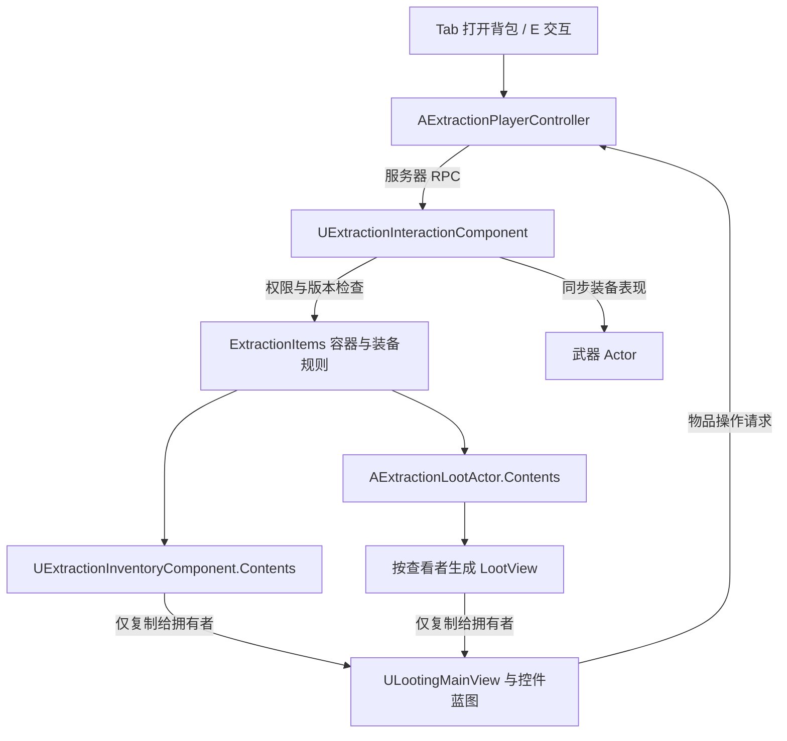
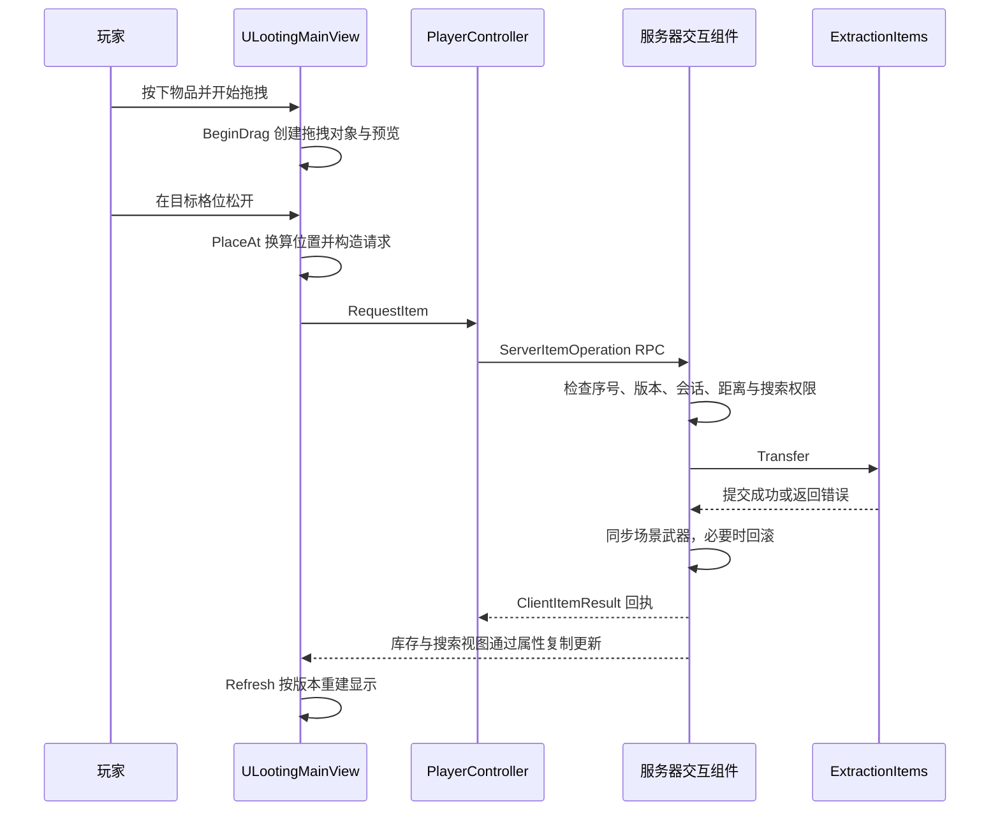

# BrokenEdge 背包系统实现原理

本文依据 2026-10-29 工作区源码编写，基线提交为 `0711fc2ea`。重点解释项目自己的背包、搜索与装备实现，不展开引擎底层控件机制。

本文是源码分析，不代表本轮重新完成了联网、打包或完整对局验收。文中的流程图是对实际调用关系的整理，示例请求用于解释字段含义。

## 1. 先理解整体结构

背包不是一个 Widget 内部维护的物品数组。它由物品数据、服务器操作规则和客户端界面共同组成：界面显示客户端收到的状态，玩家操作产生请求，服务器校验后修改库存，再把结果同步回来。



| 对象 | 主要职责 | 阅读入口 |
|---|---|---|
| `AExtractionPlayerController` | 按键、界面生命周期、输入模式、服务器 RPC 与操作回执 | [ExtractionPlayerController.cpp](../../Source/BrokenEdge/Extraction/ExtractionPlayerController.cpp) |
| `ULootingMainView` | 背包主界面、右键菜单、拖拽、拆分、装备目标 | [LootingMainView.cpp](../../Source/BrokenEdge/Extraction/LootingMainView.cpp) |
| `ULootingWidgetPart` | 物品卡片、网格等可复用界面部件及其输入响应 | [LootingMainView.h](../../Source/BrokenEdge/Extraction/LootingMainView.h) |
| `UExtractionInteractionComponent` | 打开容器、搜索进度、距离检查、执行操作与医疗计时 | [ExtractionInteractionComponent.cpp](../../Source/BrokenEdge/Extraction/ExtractionInteractionComponent.cpp) |
| `UExtractionInventoryComponent` | 玩家或守卫的局内库存，以及库存和场景武器之间的同步 | [ExtractionInventoryComponent.cpp](../../Source/BrokenEdge/Extraction/ExtractionInventoryComponent.cpp) |
| `AExtractionLootActor` | 世界中的散落物、物资箱或死亡物资，保存服务器容器 | [ExtractionLootActor.cpp](../../Source/BrokenEdge/Extraction/ExtractionLootActor.cpp) |
| `ExtractionItems` 命名空间 | 占格、移动、堆叠、拆分、装备兼容性和改装规则 | [ExtractionItems.cpp](../../Source/BrokenEdge/Extraction/ExtractionItems.cpp)、[ExtractionEquipment.cpp](../../Source/BrokenEdge/Extraction/ExtractionEquipment.cpp) |

玩家的库存组件在 `AExtractionPlayerState` 构造函数中创建。角色上的交互组件通过 PlayerState 获取库存；守卫则可使用角色自己的 `GuardInventory`。因此，玩家库存的归属和当前操控的 Pawn 并不是同一个概念。见 [ExtractionState.cpp](../../Source/BrokenEdge/Extraction/ExtractionState.cpp) 和交互组件的 `Inventory()`。

## 2. 物品定义、实例与容器

数据结构集中在 [ExtractionItems.h](../../Source/BrokenEdge/Extraction/ExtractionItems.h)。阅读时应先区分以下三层。

### 2.1 物品定义：这一类东西有什么规则

`UExtractionItemDefinition` 是 DataAsset，描述物品种类的稳定规则，例如显示名称、类别、尺寸、最大堆叠数量、图标、世界模型、武器类、兼容弹药和附件，以及医疗效果。

例如，同一弹药定义可以对应背包里的多堆弹药。它们共享定义，但数量、格位和实例 ID 各不相同。

### 2.2 物品实例：这一件东西现在是什么状态

`FExtractionItem` 保存具体物品的状态：

| 字段 | 含义 |
|---|---|
| `Id` | 物品实例的 GUID，用于查找具体条目 |
| `Definition` | 物品定义标识，不是实例 ID |
| `Quantity` | 这一堆的数量 |
| `Cell`、`Size`、`Rotated` | 网格位置、尺寸和旋转状态 |
| `Slot` | 装备槽或网格分区 |
| `Magazine`、`MagazineAmmo` | 弹匣内数量与弹种 |
| `Durability` | 耐久状态 |
| `Attachments` | 已安装附件的实例信息 |
| `Origins` | 用于服务器来源追踪的批次信息，不参与该字段的网络复制 |

`Id` 回答“是哪一件物品”，`Definition` 回答“是什么种类”，来源批次回答“从哪里来”。三者不能互相替代。

### 2.3 容器：这些东西放在哪里

`FExtractionContainer` 保存容器 ID、版本号 `Revision`、网格参数和 `Items`。同一套结构既能表示自身库存，也能表示地面物资容器；具体可用分区取决于容器配置及携行装备。

玩家携行装备的槽位约定如下：

| Slot | 含义 |
|---|---|
| `0 / 1` | 两个武器装备槽 |
| `2 / 3` | 头盔 / 护甲 |
| `4 / 5 / 6` | 胸挂 / 背包 / 安全箱本体 |
| `-2 / -1 / -3` | 胸挂 / 背包 / 安全箱内部网格 |

例如，“背包装备在槽 5”与“物品放进背包网格 -1”是两回事。当前实现通过同一容器中物品的 `Slot` 区分这些分区，并不是每个背包实例递归持有一个独立容器。

### 2.4 放置与转移算法

`Fits()` 检查装备类别、槽位占用，或者检查旋转后的矩形是否越界、是否与同分区其他物品重叠。

`AutoPlace()` 在候选副本中先合并已有堆叠，再尝试两个朝向、逐行逐列寻找空位。默认自动放置优先胸挂，其次背包；安全箱需要明确指定，避免拾取物品自动进入安全箱。全部放置成功后才替换原容器。

`Transfer()` 统一处理同容器移动、跨容器转移、拆分和合并：

1. 查找实例并检查数量、目标槽位；携行装备的内部网格未清空时，拒绝移走装备本体。
2. 复制来源和目标容器。在同容器移动时使用同一个候选副本。
3. 整件移动保留实例 ID；拆出部分数量时，为拆出的新堆生成新 ID，并分配对应来源数量。
4. 根据请求执行指定合并、自动放置或精确格位放置，再验证容器完整性。
5. 成功才提交候选数据，并递增受影响容器的 `Revision`。

指定 `MergeInto` 的合并要求目标能容纳请求的全部数量；不要将它与 `AutoPlace()` 尝试多个已有堆叠的过程混为一谈。

## 3. 背包如何打开与关闭

### 3.1 界面实例何时创建

控制器的 `InventoryWidgetClass` 默认引用 `/Game/UI/Looting/WBP_LootingPickupView_Pc`，C++ 父类为 `ULootingMainView`。

当前通过 `EnsureLocalWidgets()` 在本地控制器生命周期入口创建界面，加入视口的层级为 60；不再在 Tick 中创建背包。Tick 仍调用 `InventoryWidget->Refresh()`。`EndPlay()` 移除并清空引用，`PostSeamlessTravel()` 的初始化路径可重新挂载已有界面。

`WBP_ExtractionHUD` / `UExtractionWidget` 负责对局状态、生命、武器、撤离等 HUD 信息，背包窗口则由 `WBP_LootingPickupView_Pc` / `ULootingMainView` 负责。两者不应混淆。

### 3.2 Tab 打开自身背包

实际路径是：

```text
Tab
  → ToggleInventory()
  → RequestOpenInventory(nullptr, !InventoryOpen)
  → ServerOpenInventory(...)
  → UExtractionInteractionComponent::Open(...)
  → InventoryOpen 复制回拥有者
  → ULootingMainView::Refresh() 显示 InventoryBody
```

`RequestOpenInventory()` 取本地和已复制会话编号的较大值，再加一。服务器 `Open()` 仅接受更新的编号，先关闭旧交互，再检查是否允许打开。

打开背包会停止持续射击，并在服务器取消换弹、退出瞄准。控制器根据背包、菜单、观战等状态选择 `GameAndUI` 或 `GameOnly` 输入模式，并控制鼠标显示。

### 3.3 E 交互有两个不同分支

`Interact()` 优先处理救援，其次钥匙门、战利品目标；并不是所有 E 输入都用于拾取。

对战利品目标，服务器会检查门是否解锁、距离是否不超过 200 厘米，以及视线是否被阻挡，然后按目标类型处理：

- **散落物 `Loose=true`：**直接尝试转移物品，不打开搜索窗口。拾取武器时会尝试空闲武器槽；同步场景武器失败时恢复库存。
- **普通容器：**设置 `InventoryOpen=true`、`Loot=Target`，建立查看者的 `LootView`，进入搜索界面。

关闭时，`Close()` 清除当前目标、临时视图和搜索计时，但保留该交互组件中已经揭示过的物品记录。服务器 Tick 还会在玩家无法行动或离开目标可交互范围时关闭交互。

## 4. UI 如何把库存画出来

背包使用控件蓝图定义布局，C++ 通过 `BindWidget` 获取 `InventoryBody`、`OwnContainer`、`LootContainer`、`EquipmentList`、`ContextMenu`、`SplitDialog` 等控件。定义见 [LootingMainView.h](../../Source/BrokenEdge/Extraction/LootingMainView.h)，资产位于 [Content/UI/Looting](../../Content/UI/Looting)。

`MakePart()` 根据配置的控件类创建物品卡片等部件，并把部件的 `Inventory` 指向主界面。`RebuildEquipment()` 构建装备目标，`RebuildContainer()` 根据容器网格和物品实例构建对应显示。

主界面读取的两侧数据不同：

- `Container(false)`：自己的 `UExtractionInventoryComponent::Contents`。
- `Container(true)`：当前搜索目标对应的 `UExtractionInteractionComponent::LootView`。

客户端界面不直接读取世界物资箱的完整服务器 `Contents`。

虽然 `Refresh()` 每帧被调用，但不会每帧重建整个物品列表。它在首次打开、容器 ID 改变或 `Revision` 改变时重建对应一侧；同时更新搜索倒计时、提示、可见性和旋转输入。会话改变、界面关闭或选中的物品已不存在时，会取消拖拽。

## 5. 一次拖拽拾取的完整过程

下面以“把物资箱中已经搜索出的物品拖到自身背包”为例。



图中的回执和属性复制是两条更新路径，不表示客户端一定按图中的先后顺序收到它们。

### 5.1 从按下鼠标到拖拽预览

`ULootingWidgetPart::NativeOnMouseButtonDown()` 选择物品。右键显示菜单，Shift+左键走快捷转移；普通左键记录鼠标抓取点在物品矩形中的比例 `GrabFraction`，并请求检测拖拽。

随后 `NativeOnDragDetected()` 调用主界面的 `BeginDrag()`，创建 `ULootingDragDropOperation`，保存物品 ID、来源侧、数量、旋转和抓取比例，同时创建跟随鼠标的预览控件。

这个拖拽对象保存操作上下文和视觉预览，不是物品的新权威副本。

### 5.2 松手时如何确定目标格子

`PlaceAt()` 先检查装备槽目标，再检查自身或战利品侧网格。对于网格，它执行：

```text
屏幕坐标
  → ItemCanvas 的局部坐标
  → 除以 CellSize，换成格子单位
  → 根据纵向位置确定胸挂、背包等分区
  → 减去分区顶部偏移
  → 减去抓取比例 × 旋转后的物品尺寸
  → 向下取整，得到物品左上角 Cell
```

减去抓取偏移，是为了让鼠标从物品中间抓起时，松手后仍保持相同的相对位置。如果松手位置落在另一个物品上，还会填写 `MergeInto`，由服务器判断能否堆叠。

### 5.3 请求携带什么

`ULootingMainView::Request()` 填入选中物品、来源、数量和旋转；`PlaceAt()` 进一步指定目标侧、槽位、格位，并关闭自动放置。

例如，一个拖到自身背包的请求可以理解为：

```text
Op        = Transfer
FromLoot  = true
ToLoot    = false
Item      = 被拖动物品的 GUID
Quantity  = 请求移动数量
Slot      = -1       // 自身背包网格
Cell      = (2, 1)   // 目标左上角，示意值
AutoPlace = false    // 使用玩家指定格位
```

控制器 `RequestItem()` 再补齐递增 `Sequence`、当前 `Session`、`InventoryRevision` 和 `LootRevision`，发送服务器 RPC。UI 随后清理拖拽状态，实际物品位置等待服务器数据更新。

### 5.4 其他常见操作怎样复用这条链

| 操作 | 实现方式 |
|---|---|
| R 旋转 | 修改拖拽朝向和预览尺寸，最终放置请求携带 `Rotated` |
| Shift+左键 | `QuickTransfer()` 构造快捷转移；没有外部容器时可能进入装备处理 |
| 拆分 | 拆分窗口选择数量，进入等待放置状态；最终仍由 `Transfer()` 在服务器拆出新实例 |
| 穿戴装备 | 将物品转移至对应装备槽，服务器检查类别和占用 |
| 丢弃 | 服务器先生成散落物容器，再转移物品；失败时销毁临时对象或回滚 |
| 使用医疗品 | 服务器启动医疗计时，完成时再检查和应用效果；移动、下落等可中断 |

## 6. ExtractionEquipment.cpp 负责什么

[ExtractionEquipment.cpp](../../Source/BrokenEdge/Extraction/ExtractionEquipment.cpp) 实现的是 `ExtractionItems` 命名空间中的装备规则。它没有另建一套库存，也不负责直接生成场景里的枪。

### 6.1 EquipmentActions：生成可供 UI 展示的操作

`EquipmentActions()` 根据选中物品和当前容器生成 `FEquipmentAction` 列表，包括操作名称和候选 `FExtractionItemRequest`。

它会枚举穿脱护甲、装备或卸下携行装备、安装兼容附件、拆卸附件、卸弹、选择弹种及精调等操作。普通武器菜单中的“改装与参数对比”还可通过 `OpenGunsmith` 打开改装界面。

**菜单里出现一个选项，不代表服务器已经批准该操作。** 菜单使用当前可见状态生成，执行时仍可能因版本变化、空间不足或附件不兼容而失败。

护甲和携行装备的穿脱主要通过 `Transfer` 改变槽位；附件安装和武器改装则由 `Configure()` 处理。

### 6.2 Configure：在候选容器中执行武器改装

`Configure()` 要求操作自己的库存，拒绝 `FromLoot` 或 `ToLoot` 请求。它复制容器为 `Next`，找到目标枪械，再执行具体分支：

| 分支 | 数据变化与约束 |
|---|---|
| `Attach` | 从普通物品列表取出附件，变成枪械 `Attachments` 中的记录；保留 ID、来源、父件、插槽和精调信息 |
| `Detach` | 拆下指定附件及其后代，转回散件并尝试放入网格；任意一件放不下就放弃候选改动 |
| `Tune` | 更新指定已安装附件的精调值，随后由完整校验检查合法性 |
| `Unload` | 将弹匣弹药转换为库存物品；空间不足则不提交 |
| `SelectAmmo` | 检查弹种兼容性；弹匣里仍有另一种弹药时要求先卸弹 |

最后检查弹匣容量变化、执行完整容器 `Validate()`，通过后才递增 `Next.Revision` 并替换原容器。

### 6.3 ValidateItem 与场景表现是两个环节

`ValidateItem()` 检查数量、尺寸、耐久、弹药、附件身份与父子关系、兼容性及精调范围和步长等。`Unmount()` 则把已安装附件记录转换回普通物品实例。

这些函数改变或验证的是数据。服务器 `Execute()` 在装备数据变更后还会调用库存组件的 `SyncWeapons()`，将武器实例同步为场景中的武器 Actor、弹药和附件表现。同步失败时，上层恢复之前的库存快照。

因此，修改装备功能时需要同时考虑“数据是否合法”与“场景武器是否同步成功”，不能只修改 UI 图标或可见枪械。

## 7. 多人操作如何保持一致

### 7.1 三种编号各管一件事

打开一个普通 UI 本身不需要会话编号。这里的 `Session` 是本次容器交互的编号，用来让服务器判断：物品操作是否仍属于当前这一次打开的搜刮界面。

| 字段 | 用途 | 当前校验边界 |
|---|---|---|
| `Sequence` | 拒绝重复或过期物品请求 | `Execute()` 拒绝不大于 `LastSequence` 的编号；接受新编号后即更新水位，即使后续操作失败 |
| `Session` | 区分不同开关容器会话 | `Open()` 要求新编号；物品操作涉及 `FromLoot` 或 `ToLoot` 时核对当前会话 |
| `InventoryRevision` / `LootRevision` | 确认请求基于当前容器状态 | 检查自身库存版本；涉及外部容器时再检查真实 Loot 版本 |

版本号是请求的前置条件，客户端不能通过填写它来指定服务器的新版本。当前纯自身库存操作不走外部容器会话检查分支，不能把这一点写成“所有操作都校验 Session”。

例如，玩家连续切换交互目标时，可以产生下面的编号（数值仅为示意）：

```text
打开箱子 A → Session = 10
关闭界面   → Session = 11
打开箱子 B → Session = 12
```

服务器当前已处于会话 `12` 时，携带会话 `10` 的外部容器操作应被拒绝，避免把旧交互状态下的操作套用到当前容器。这不必以网络消息乱序为前提：客户端显示的状态可能尚未跟上服务器，基于旧状态发出的请求也需要被识别。

源码将这项检查分成三个环节：

1. [ExtractionPlayerController.cpp](../../Source/BrokenEdge/Extraction/ExtractionPlayerController.cpp) 的 `RequestOpenInventory()` 取本地编号与已复制编号的较大值，再加一；打开、关闭和切换目标都通过这个入口发出请求。`RequestItem()` 则把交互组件当前的 `Session` 填进物品操作请求。
2. [ExtractionInteractionComponent.cpp](../../Source/BrokenEdge/Extraction/ExtractionInteractionComponent.cpp) 的 `Open()` 只接受大于当前 `Session` 的编号，更新编号后关闭旧交互，再根据请求决定是否打开新目标。
3. 同文件的 `Execute()` 在 `FromLoot` 或 `ToLoot` 为真时执行以下检查：

```cpp
if (!InventoryOpen || R.Session != Session || !Loot || !CanReach(Loot))
    return TEXT("搜索已关闭或超出距离");
```

因此，即使会话编号匹配，界面已经关闭、目标不存在或目标超出可交互范围，也不能继续操作外部容器。仅在自身库存内移动物品时，不进入这个分支，仍需通过请求序号、库存版本等其他校验。

`Session` 也不能替代 `Revision`：另一名玩家取走箱子中的物品时，你仍处于同一次打开的会话，但箱子的数据版本已经变化，基于旧版本的请求仍应被拒绝。下一节展示这个过程。

[ExtractionAbilities.h](../../Source/BrokenEdge/Extraction/ExtractionAbilities.h) 中 `ServerBegin()`、`ServerCancel()` 使用的 `Sequence` 属于能力组件自身的动作请求序号，由该组件的 `LocalSequence`、`LastSequence` 跟踪；它与背包容器会话编号、物品操作请求序号不是同一套计数。

### 7.2 两个人同时拿同一物品

假设 A、B 都看到物资箱版本 10。A 先成功拿走物品，服务器物资箱版本变为 11。B 随后发送基于版本 10 的请求时，服务器拒绝操作，刷新其 `LootView`，返回“容器已变化，请重试”。

最终修改由服务器串行处理，UI 中的拖拽预览不具备修改服务器库存的权力。版本检查之外，服务器仍检查物品是否存在、数量、交互距离、门锁、搜索权限和动作状态。

### 7.3 搜索不是简单隐藏图标

世界物资 Actor 的完整 `Contents` 不参与属性复制。每个查看者通过自己的交互组件生成 `LootView`；搜索记录按容器 ID 和物品 ID 保存。

`RefreshLootView()` 先复制服务器容器，再清除未揭示条目的 ID、定义、数量、弹匣信息、耐久和附件。仍保留用于布局的部分字段，因此这是按字段裁剪的搜索视图，不能理解为未知条目完全不向客户端发送。

`AdvanceSearch()` 按槽位和网格顺序逐件搜索，每件设置约一秒完成时间；其他玩家拿走正在搜索的物品时，当前搜索会被取消。一个人搜过，并不意味着另一个人自动知道内容。

自身库存 `Contents`，以及交互组件的 `InventoryOpen`、`Session`、`LootView` 等状态使用 `COND_OwnerOnly` 复制。这样其他客户端不会通过这些属性收到该玩家的完整库存和私有搜索状态。

### 7.4 失败为何不会只改了一半

这里有两层保护：

1. `Transfer()` / `Configure()` 先改候选副本，空间或规则校验失败时不提交原容器。
2. `Execute()` 保留改动前库存和 Loot 快照；如果后续 `SyncWeapons()` 失败，恢复快照，并销毁本次临时生成的掉落物。

成功后调用 `Changed()`、刷新搜索视图，并请求网络更新。注意，库存组件的 `Changed()` 主要同步备弹、调用 `ForceNetUpdate()` 和记录日志；它不是统一递增 Revision 的入口，修改数据的具体路径负责维护版本。

`ClientItemResult()` 返回序号和错误文本，用于提示和记录已回执水位；它没有携带完整库存。库存内容仍由属性复制更新。空错误字符串通常表示该请求入口成功，例如医疗请求可能只是成功开始计时，不等于治疗已经完成。

## 8. 死亡掉落、仓库与撤离结算

### 8.1 死亡或离局掉落

库存组件的 `DropAll()` 仅在服务器执行，使用 `bDropped` 防止重复掉落。它先从场景武器捕获当前状态，再复制库存并移除受保护条目，生成死亡物资容器。

`ExtractionItems::Protected()` 将安全箱本体（槽 6）和安全箱网格内物品（槽 -3）视为受保护内容。创建非空掉落容器失败时，函数直接返回，不清空原库存；成功后才标记已掉落、清理局内库存并更新同步。

### 8.2 局内库存不是持久化仓库

`InitializeLoadout()` 从出战记录初始化局内携带物品，并防止同一世界重复初始化。仓库、出战记录、结果和持久化事务由 [ExtractionPersistence.h](../../Source/BrokenEdge/Extraction/ExtractionPersistence.h) / [ExtractionPersistence.cpp](../../Source/BrokenEdge/Extraction/ExtractionPersistence.cpp) 管理。

`AExtractionGameMode` 的结算路径调用 `Settle()`。该函数按结局筛选保留物品：成功撤离保留全部携带物资，其他结局保留安全箱及其中物品，并在持久化流程中处理入库与来源批次。

因此，“拖动背包格子”“死亡时生成物资箱”“撤离后存入仓库”是三个相互连接但职责不同的流程。关闭背包窗口不会自动执行撤离结算。

## 9. 修改功能时从哪里入手

| 想修改的内容 | 优先查看 |
|---|---|
| 窗口布局、颜色、字体 | `Content/UI/Looting` 中的控件蓝图 |
| 物品卡片、拖拽坐标、右键菜单 | `LootingMainView.cpp` |
| 新物品的尺寸、堆叠数、图标、兼容性 | `UExtractionItemDefinition` 及对应 DataAsset |
| 网格占用、自动放置、拆分与合并 | `ExtractionItems.cpp` |
| 穿脱选项、附件装卸、精调与卸弹 | `ExtractionEquipment.cpp` |
| 距离、会话、版本、搜索和动作限制 | `ExtractionInteractionComponent.cpp` |
| 背包与场景武器同步、死亡掉落 | `ExtractionInventoryComponent.cpp` |
| 按键、RPC、鼠标模式和界面生命周期 | `ExtractionPlayerController.cpp` |
| 仓库和撤离后保存 | `ExtractionPersistence.cpp` 与 `ExtractionGameMode.cpp` |

建议阅读顺序为：`ExtractionItems.h` → `LootingMainView::Request/PlaceAt` → `PlayerController::RequestItem` → `InteractionComponent::Execute` → `ExtractionItems::Transfer/Configure` → `InventoryComponent::SyncWeapons` → `LootingMainView::Refresh`。这一圈读完，就能把“鼠标操作”与“服务器物品变化”对应起来。

排查时可先看 `EXTRACTION_ITEM_RESULT` 的错误文本，再结合 `EXTRACTION_TRANSFER` 和 `EXTRACTION_INVENTORY` 日志判断请求是否执行、容器版本是否改变。修改联网逻辑后仍需实际测试，源码中的检查和回滚设计本身不能替代多人运行验收。
