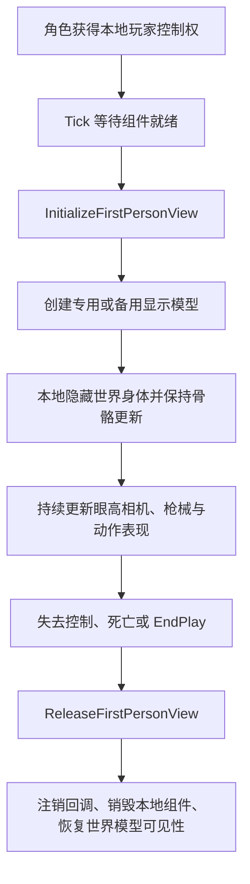

# 固定第一人称实现说明

本项目已取消玩家的第一、第三人称视角切换。玩家获得本地角色控制权后自动初始化第一人称；世界人物模型继续负责其他玩家所见的身体、阴影、武器挂点和动画通知。

本文替代原有的双视角切换说明。文件名保留，方便已有链接继续访问。

## 1. 生命周期

`InitializeFirstPersonView()` 只处理已开始游戏、由本地玩家控制、未死亡且未禁用操作的角色，排除 AI 守卫。组件尚未就绪时等待后续 Tick；资源明确缺失时只记录一次错误，不退回第三人称。控制权变化后允许重试。

`ReleaseFirstPersonView()` 可重复调用。它清空本地表现状态、释放人物与武器显示组件、注销骨骼回调并恢复世界模型设置，不切换到其他角色相机。

源码：[BrokenEdgeCharacter.cpp](../../Source/BrokenEdge/Character/BrokenEdgeCharacter.cpp)、[声明](../../Source/BrokenEdge/Character/BrokenEdgeCharacter.h)。

## 2. 相机与世界人物

- 同一个 `FollowCamera` 始终挂在胶囊体上，使用控制器旋转；位置由角色眼睛位置和按 Yaw 旋转的 `FirstPersonCameraOffset` 更新。
- `CameraBoom`、视角切换输入、`bStartInFirstPerson`、第三人称相机缓存与恢复逻辑已移除。
- `IsFirstPersonView()` 保留给现有武器及 UI 调用，表示本地第一人称表现是否已启用，不再表示可切换的用户偏好。
- 世界人物在第一人称下使用 OwnerNoSee，仅对拥有者隐藏；仍更新动画姿势和骨骼，保留隐藏阴影。
- AI、远端人物和大厅展示模型保留。死亡后的现有观战相机是独立系统，不属于已删除的视角切换功能。

## 3. 人物和枪械表现

配置了 `FirstPersonMeshAsset` 与 `FirstPersonAnimClass` 时，创建挂在相机下的专用人物组件 `DedicatedFirstPersonMesh`。否则保留 `FirstPersonBody` 备用路径，在世界人物骨骼最终更新后复制姿势。两条路径都仅对拥有者显示，关闭碰撞、重叠和阴影，并隐藏头骨。

专用枪模优先使用武器的 `Presentation->ViewMesh`，其次使用来源匹配的角色级替代网格，最后使用世界武器网格。适配模式下挂到相机，否则挂到人物右手插槽；瞄准偏移、视觉后坐力和握持适配保持原有行为。

世界武器继续存在，主、副武器在拥有者第一人称下隐藏，掉落或失去持有者时恢复。相关实现见 [Weapon.cpp](../../Source/BrokenEdge/Weapon/Weapon.cpp)。

## 4. 动画同步

第一人称动画类负责显示，不承担伤害或换弹结算。`SyncFirstPersonAction()` 仍以世界人物蒙太奇为时间基准，将有效动作区段的进度映射到第一人称蒙太奇。切枪继续参考挂枪通知和 `SwapAttachFraction`；动作结束、被中断或死亡时终止对应表现。

这里仍存在两套动画，是因为本地玩家和观察者需要不同的表现，不是仍然允许玩家切换第三人称。

动画类：[StingerFirstPersonAnimInstance.h](../../Source/BrokenEdge/Character/StingerFirstPersonAnimInstance.h)、[实现](../../Source/BrokenEdge/Character/StingerFirstPersonAnimInstance.cpp)。

## 5. 配置、迁移与维护

保留人物网格、动画类、头骨、隐藏材质槽、相机偏移、武器适配、开镜及动作蒙太奇配置。C++ 默认值可被蓝图覆盖；瞄准插值不等于相机视角切换。

`Scripts/Stinger/migrate_fixed_first_person.py` 在编译后更新相关角色蓝图相机默认值，从输入上下文清理旧视角映射，确认无引用后删除旧 Input Action。迁移不重置其他角色参数。

维护重点：

- 不能因为本地隐藏世界人物就停止其骨骼和动画通知更新。
- 新增本地显示组件或回调时，同时维护清理路径。
- 不要把用于世界人物动画的 ThirdPerson 名称误认为待删除的相机功能。
- 初始化失败应排查人物资源和头骨配置，不恢复第三人称退路。

验证应覆盖自动初始化、旧按键不再切换、持枪与瞄准、换弹、失去控制与重新控制、死亡清理及远端世界人物显示。具体本轮验证结果以交付说明和 `Saved/FixedFirstPerson` 中的报告为准，不把静态源码说明视为完整游戏验收。
