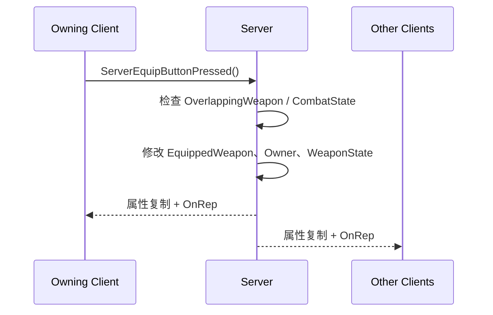
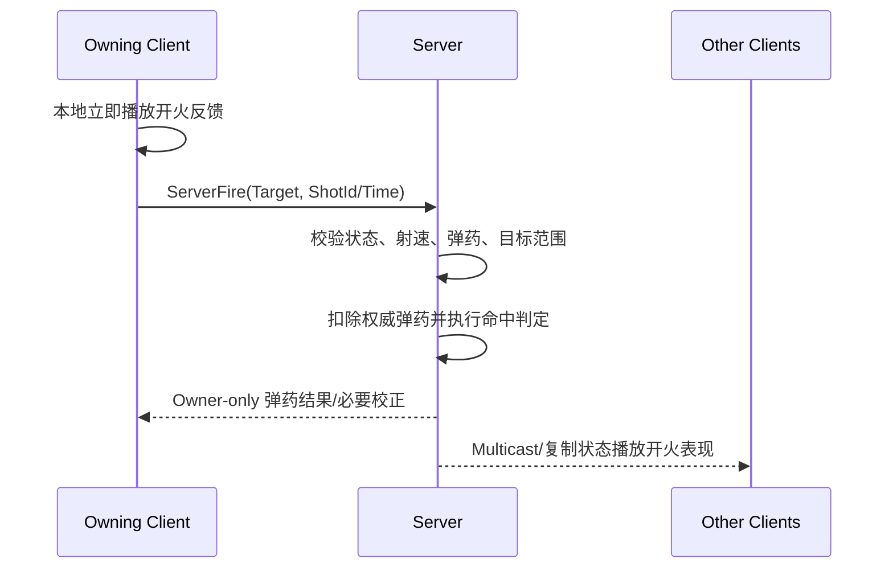

# BrokenEdge 已完成功能、网络同步分析与后续开发路线

> 项目：`C:\UnrealProjects\BrokenEdge`
>
> 参考项目：`D:\SourceFiles\UnrealProjects\UE5BlasterLearning-main`
>
> 审查日期：2026-08-21
>
> 定位：用于 Unreal Engine 5.5.4 多人第三人称射击项目的课堂教学与阶段验收

## 1. 结论先行

BrokenEdge 当前已经完成了一个多人第三人称射击项目的主要基础层：角色移动与视角、蹲伏、武器拾取、主副武器装备与切换、瞄准、动态准星、生命/护盾 HUD、四类属性拾取物，以及换弹与备用弹药的主体代码。

在继续增加开火、伤害、淘汰等新玩法前，当前最重要的是先把已有功能的正确性和联机闭环补齐：

- 换弹存在空指针和 Listen Server 重复播放风险；
- 武器重叠提示没有形成服务器权威闭环；
- 主副武器、战斗状态和弹匣弹药的远端同步不完整；
- 速度/跳跃 Buff 没有同步客户端预测参数；
- HUD、远端 Aim Offset、准星状态和输入禁用仍有不一致；
- 多处无效 Tick、运行时测试代码和宽松成员权限可以收紧。

因此，**当前执行重点调整为“优化现有功能”，暂不开发参考项目中的新功能，也不把会话系统纳入本轮优化范围**。推荐顺序是：崩溃与服务器权威状态 → 远端表现与 HUD → 性能、封装和命名。原来的命中扫描射击路线保留在后文作为暂缓计划。

## 2. 审查方法与结论边界

本次结论来自：

- 当前项目 `Source/BrokenEdge`、`Plugins/MultiplayerSessions`、`Config` 与 Target 文件；
- `BP_BrokenEdgeCharacter`、`BP_BrokenEdgeGameMode`、`BP_BrokenEdgeHUD` 和地图资产中可读取的类/资源引用；
- 当前项目与完整参考项目的源码类和关键调用链对照；
- 当前工作区的静态检查。

状态标记含义：

| 标记 | 含义 |
| --- | --- |
| 已实现 | 当前源码或资产中存在完整的主要调用链 |
| 部分实现 | 已有主体结构，但回调、远端表现或边界处理仍不完整 |
| 仅预留 | 只有类型、碰撞盒、枚举、注释或空函数，不能当作可用功能 |
| 未实现 | 当前项目没有对应入口或业务链 |

本文没有修改 C++ 或 Blueprint 业务逻辑。除非在文末验证记录中另有说明，“已实现”表示有静态代码/资产证据，不自动等于已经通过 Listen Server、Dedicated Server、丢包、延迟、打包和多人运行测试。

## 3. 当前项目架构

| 层 | 当前主要类 | 职责 |
| --- | --- | --- |
| 玩家输入与角色 | `ABrokenEdgeCharacter` | Enhanced Input、移动、跳跃、蹲伏、装备、瞄准、换弹、动画入口 |
| 战斗状态 | `UCombatComponent` | 主副武器、瞄准、准星追踪、换弹、备用弹药、战斗状态复制 |
| 武器 | `AWeapon`、`AHitScanWeapon` | 武器状态、碰撞、拾取提示、挂接、弹药 HUD；命中扫描尚未实现 |
| 属性增益 | `UBuffComponent` | 治疗、回盾、加速、跳跃增益及定时恢复 |
| 拾取物 | `APickup` 及四个派生类 | 服务器判定重叠，触发属性增益并销毁拾取物 |
| 本地 UI | `ABrokenEdgePlayerController`、`ABrokenEdgeHUD`、`UCharacterOverlay` | 把本地角色数据写入生命、护盾、弹药和动态准星 UI |
| 游戏规则 | `ABrokenEdgeGameMode` | 当前主要负责默认 Pawn；淘汰、重生、计分、比赛状态尚未实现 |
| 会话 | `UMultiplayerSessionsSubsystem`、`UMenu` | Online Subsystem Null 下的建房/搜房基础结构与菜单入口 |

资产引用检查显示，`BP_BrokenEdgeGameMode` 配置中引用了：

- `BP_BrokenEdgeCharacter`；
- `BP_BrokenEdgePlayerController`；
- `BP_BrokenEdgeHUD`。

这比只看 `ABrokenEdgeGameMode` 构造函数中的 C++ 默认 Pawn 更接近实际配置。`MainMap` 资产中也能找到 `BP_BrokenEdgeGameMode`、四类拾取物和武器实例引用。不过，本次没有在 Unreal Editor 的 World Settings/蓝图 Defaults 面板中逐项目视复核，所以这里记录的是二进制资产引用证据，不把它扩大为运行时 PIE 结论。

## 4. 已完成与已搭建的功能

### 4.1 角色输入与基础移动：已实现

角色使用 Enhanced Input，当前输入包括：

- 移动 `IA_Move`；
- 视角 `IA_Look`；
- 跳跃 `IA_Jump`；
- 蹲伏 `IA_Crouch`；
- 装备/切枪 `IA_Equip`；
- 瞄准 `IA_Aim`；
- 换弹 `IA_Reload`。

输入绑定位于 [`BrokenEdgeCharacter.cpp`](../Source/BrokenEdge/Character/BrokenEdgeCharacter.cpp#L319)。`BP_BrokenEdgeCharacter` 中也能读取到上述 Input Action、`IMC_CharacterDefault`、`AM_Swap`、`AM_Reload` 和 `AM_HitReact` 的资产引用，因此它们不只是 C++ 中未赋值的声明。

角色移动本身依赖 `ACharacter` 和 `UCharacterMovementComponent` 的引擎网络预测与移动复制，不是项目自己为每一帧位置编写 Server RPC。

### 4.2 角色动画数据：已实现主体

`UBrokenEdgeAnimInstance` 已计算并向动画蓝图暴露：

- 速度、是否腾空、是否加速、是否蹲伏；
- 是否装备武器、是否瞄准；
- 偏航差、倾斜、瞄准偏移；
- FABRIK、Aim Offset 和右手变换等动画状态；
- 武器切换与本地换弹状态。

角色还包含 Aim Offset、原地转向和远端 Pitch 压缩值修正。这里已经具备教学“本地控制角色与模拟代理动画数据差异”的条件，但 `RotateInPlace()` 中的模拟代理分支仍有 TODO/注释代码，因此应做双客户端可见性验收。

### 4.3 武器拾取、装备和切换：部分实现

当前已经具备：

- 武器 Actor 开启复制和移动复制；
- 武器重叠检测与拾取 Widget；
- `WeaponState` 的 `ReplicatedUsing`；
- 主武器挂到右手、第二武器挂到背包；
- 丢弃旧主武器；
- 主副武器交换；
- 交换蒙太奇与 Anim Notify 调用入口；
- 旗帜类型、左手挂点和持旗状态的预留结构。

服务器装备入口为 [`ServerEquipButtonPressed`](../Source/BrokenEdge/Character/BrokenEdgeCharacter.cpp#L639)，主要状态在 [`CombatComponent.cpp`](../Source/BrokenEdge/Component/CombatComponent.cpp#L49) 中修改。

仍不能把这一模块标记为“联机表现全部完成”，因为：

- `OnRep_OverlappingWeapon()` 为空，远端 Owning Client 的拾取提示可能不更新；
- `OnRep_SecondaryWeapon()` 为空；
- `OnRep_CombatState()` 为空，模拟代理可能不会播放切枪/换弹蒙太奇；
- `OnRep_HoldingTheFlag()` 和 `OnRep_Flag()` 为空，夺旗玩法只是结构预留。

### 4.4 瞄准、追踪与动态准星：已实现主体

已有链路：

```text
IA_Aim
  -> Character::AimButtonPressed/Released
  -> CombatComponent::SetAiming
  -> 本地立即修改 bAiming 与移动速度
  -> ServerSetAiming RPC
  -> 服务器复制 bAiming
```

本地玩家每帧使用 `TraceUnderCrosshairs()` 得到屏幕中心射线结果，并由 `SetHUDCrosshairs()` 综合：

- 基础扩散；
- 移动速度；
- 腾空；
- 瞄准；
- 准星目标颜色。

HUD 再绘制中心、上下左右五张准星纹理。这个追踪结果可以直接作为下一阶段开火目标点的来源。

### 4.5 换弹、弹匣与备用弹药：部分实现

当前源码已经具有：

- `IA_Reload` 输入；
- `Reload()` 的弹药量、战斗状态和弹匣是否已满检查；
- `ServerReload` 可靠 RPC；
- `ECS_Reloading` 战斗状态；
- 按武器类型选择换弹蒙太奇段；
- Anim Notify 触发 `FinishReloading()`；
- 服务器计算装填量并从 `CarriedAmmoMap` 扣除；
- `CarriedAmmo` 使用 `COND_OwnerOnly` 复制；
- 当前弹匣和备用弹药的 HUD 接口。

关键实现位于 [`CombatComponent.cpp`](../Source/BrokenEdge/Component/CombatComponent.cpp#L125)。它适合用来讲解“客户端先播表现、服务器修改权威弹药、Owner-only 数据只发给拥有者”。

当前仍有四个重要缺口：

1. `Reload()` 在访问 `EquippedWeapon->IsFull()` 前没有先判空，未装备武器时按换弹存在空指针风险；
2. `OnRep_CombatState()` 为空，非本地模拟代理没有由复制状态触发 `HandleReload()`；
3. `AWeapon::Ammo` 不是复制属性，`ClientAddAmmo` 仍被注释，远端 Owning Client 换弹后的弹匣数字可能不同步；
4. `PlayerController::PollInit()` 缓存了备用弹药，但没有消费 `bInitializeCarriedAmmo`，Widget 晚初始化时可能漏显示。

所以这一模块应标记为“主体已搭建、联机闭环待验收和补全”。

### 4.6 生命、护盾、HUD 与受击表现：部分实现

当前已经具备：

- `Health`、`Shield` 使用 `ReplicatedUsing`；
- `OnRep_Health()` 刷新 HUD，数值下降时播放受击蒙太奇；
- `OnRep_Shield()` 刷新 HUD；
- PlayerController 负责把数据写入本地 Character Overlay；
- HUD 尚未创建时缓存生命、护盾和弹药数据，随后轮询补写；
- 蓝图 HUD 引用 `WBP_CharacterOverlay`。

该设计正确地把“网络玩法状态”和“本地 UI”分开：服务器不需要直接操作远端客户端的 Widget，远端客户端在复制值到达后，通过自己的 `OnRep` 和本地 PlayerController 更新 HUD。

但是当前角色没有绑定 `OnTakeAnyDamage`，也没有 `ReceiveDamage()`，因此生命/护盾还没有接入武器伤害；`bDisableGameplay` 虽然复制了，也没有淘汰流程去设置它。

### 4.7 属性拾取物：部分实现

已有四类拾取物：

- `AHealthPickup`：一段时间内治疗；
- `AShieldPickup`：一段时间内恢复护盾；
- `ASpeedPickup`：临时提高站立/蹲伏移动速度；
- `AJumpPickup`：临时提高跳跃速度。

`APickup` 只在服务器通过 `HasAuthority()` 绑定重叠事件，派生类触发增益后由服务器销毁拾取物。这保证了客户端不能仅靠本地重叠重复领取道具。

生命和护盾的最终值会通过 Character 属性复制到客户端。速度和跳跃增益则不同：当前对应 Multicast 代码仍被注释，增益参数本身也未复制。服务器仍会约束移动结果，但客户端预测使用的本地速度参数可能没有同步，可能出现手感不一致或位置修正。该部分需要专门做两客户端测试。

### 4.8 多人会话与运行目标：部分实现

当前项目具备：

- `BrokenEdge` Game、Editor 和 Server Target；
- `OnlineSubsystem` 默认使用 `Null`；
- `MultiplayerSessions` GameInstance Subsystem；
- 创建、查找、加入、销毁会话的接口声明和部分实现；
- 创建成功后以 `?listen` 进行 `ServerTravel`；
- 主菜单 Host/Join 按钮；
- `MainMap` 和 `Lobby` 地图；
- Dedicated Server 的连接数配置。

但当前只能把它称为“会话基础结构”，不能称为完整可用的建房加入流程：

- `UMenu` 只绑定了创建完成委托，查找和加入委托绑定被注释；
- Join 按钮只发起 `FindSessions()`，没有消费结果、选择房间、调用 `JoinSession()` 和 `ClientTravel()`；
- Join/Destroy/Start 完成回调链尚未完整接入；
- 已存在同名会话时，`DestorySession()` 调用被注释，重建会直接停住；
- Dedicated Server 分支仍会获取 `ULocalPlayer`，而专用服务器没有本地玩家，对应的 user-number 创建路径仍在注释中。

这套会话系统解决的是“怎样发现并连接某个服务器”，不负责 Health、Weapon、CombatState 等游戏内 Actor 数据的复制。

### 4.9 延迟补偿：仅预留

角色构造函数中已经创建头、躯干、四肢等 HitBox，并配置了自定义 `ECC_HitBox` 通道。这是服务器倒带命中判定需要的数据基础。

但是当前项目没有 `ULagCompensationComponent`、历史帧缓存、时间同步、Server Score Request 或回放命中确认。碰撞盒存在不等于服务器回退已经实现。延迟补偿应放在基础射击、伤害和网络测试稳定之后教学。

## 5. 当前网络同步是怎样实现的

### 5.1 三种网络角色

以一个客户端控制的角色为例：

| 实例 | 常见网络角色 | 主要职责 |
| --- | --- | --- |
| 服务器上的该角色 | Authority | 验证请求、修改权威状态、产生复制数据 |
| 拥有它的客户端 | Autonomous Proxy | 收集输入、本地预测、发送 Server RPC、显示自己的 HUD |
| 其他客户端上的该角色 | Simulated Proxy | 接收移动和属性复制，播放远端表现 |

教学时应始终问三个问题：

1. 谁产生输入？
2. 谁有权修改最终玩法状态？
3. 谁需要收到状态或表现？

### 5.2 角色移动：使用引擎内建同步

`ABrokenEdgeCharacter` 继承 `ACharacter`，移动通过 `AddMovementInput()` 驱动 `UCharacterMovementComponent`。拥有者客户端进行移动预测，服务器校验并复制权威移动，其他客户端进行平滑显示。

项目没有为 Move/Look 每帧自行调用 Reliable RPC，这是正确方向。高频连续移动不应该被实现为项目级 Reliable RPC 队列。

### 5.3 自定义属性复制

#### Character

| 属性 | 复制策略 | 客户端用途 | 当前状态 |
| --- | --- | --- | --- |
| `OverlappingWeapon` | `COND_OwnerOnly` + RepNotify | 只让拥有者看到拾取提示 | 回调为空，表现待补 |
| `Health` | 全部相关客户端 + RepNotify | 更新生命 HUD、受击表现 | 已接入 HUD，尚无伤害入口 |
| `Shield` | 全部相关客户端 + RepNotify | 更新护盾 HUD | 已接入 HUD |
| `bDisableGameplay` | 普通复制 | 统一禁用输入/战斗 | 有声明和输入检查，尚无淘汰流程 |

#### CombatComponent

| 属性 | 复制策略 | 用途 | 当前状态 |
| --- | --- | --- | --- |
| `EquippedWeapon` | RepNotify | 同步主武器、挂接和 HUD | 主链已实现 |
| `SecondaryWeapon` | RepNotify | 同步副武器 | 回调为空 |
| `bAiming` | RepNotify | 同步瞄准姿态和速度状态 | 有本地预测回写 |
| `CarriedAmmo` | `COND_OwnerOnly` + RepNotify | 只给拥有者显示备用弹药 | 值复制已接入 |
| `CombatState` | RepNotify | 换弹/切枪等互斥状态 | 回调为空 |
| `bHoldingTheFlag`、`TheFlag` | RepNotify | 夺旗状态 | 仅预留 |

#### Weapon

| 属性 | 复制策略 | 用途 | 当前状态 |
| --- | --- | --- | --- |
| `WeaponState` | RepNotify | 装备、背包、掉落状态 | 已实现主要状态切换 |
| Actor Transform/Attachment | Actor/移动复制 | 同步武器空间状态 | 已开启复制 |
| `Ammo` | 非属性复制 | 当前弹匣 | 仅装备时有 Multicast，持续同步不完整 |

### 5.4 Server RPC：客户端请求，服务器决定

当前项目已有三个主要 Server RPC：

| RPC | 客户端意图 | 服务器行为 |
| --- | --- | --- |
| `ServerEquipButtonPressed` | 拾取或切换武器 | 服务器检查重叠武器/主副武器后修改装备状态 |
| `ServerSetAiming` | 开始或停止瞄准 | 服务器更新 `bAiming` 和移动速度 |
| `ServerReload` | 请求换弹 | 服务器进入 Reloading，最终计算并修改弹药 |

以装备为例：



RPC 不是“把整个函数自动同步到所有机器”。它只是在指定网络方向上调用函数；最终状态仍需要属性复制、Actor 复制或 Multicast 传播。

### 5.5 RepNotify：状态到达后的本地反应

`ReplicatedUsing` 适合复制“最终状态”，`OnRep` 适合做客户端本地表现，例如：

```text
服务器 BuffComponent 修改 Shield
  -> Shield 被 DOREPLIFETIME 注册
  -> 客户端收到新 Shield
  -> OnRep_Shield(LastShield)
  -> 本地 PlayerController::SetHUDShield
  -> 本地 Widget 更新
```

服务器上的属性赋值通常不会因为网络复制而自动调用服务器自己的 `OnRep`。所以当前 Buff 在服务器修改数值后直接更新服务器本地 HUD，而远端客户端依靠 `OnRep` 更新，两条路径是分开的。

### 5.6 本地预测与服务器回正

瞄准和换弹已经出现简单的本地预测思想：客户端按下按键后立即改本地状态或播放蒙太奇，同时向服务器发送请求，避免等待一个往返时间才看到反馈。

`OnRep_Aiming()` 对本地控制角色使用 `bAimButtonPressed` 覆盖刚收到的旧复制值，也是为了避免网络包较慢时把玩家仍按住的瞄准临时回滚。

预测只负责响应速度，服务器仍应负责：

- 是否允许开火/换弹；
- 射速是否满足；
- 弹药是否足够；
- 命中是否成立；
- 伤害和淘汰结果。

### 5.7 Multicast 的当前用途和边界

当前武器有 `MulticastAmmo()`，装备时把弹匣值广播给所有实例。但弹药通常只需要服务器和拥有者知道，把每次弹药变化 Multicast 给所有客户端不是最佳长期设计。

更合适的划分是：

- 权威弹药：服务器修改；
- HUD 弹药：Owner-only 属性复制或 Client RPC；
- 枪口火焰、声音、蒙太奇：必要时用 Unreliable Multicast 或由复制状态触发；
- 命中和伤害：服务器最终判定，不能依赖 Multicast 决定。

## 6. 与完整参考项目的差距

| 功能域 | BrokenEdge 当前状态 | 参考项目已有内容 |
| --- | --- | --- |
| 基础开火 | 未实现 | Fire 输入、射速、自动武器、Server/Multicast Fire |
| 命中扫描 | 空类 | 射线、头部伤害、命中特效和声音 |
| 弹丸武器 | 未实现 | Projectile、Rocket、Grenade、ProjectileWeapon |
| 霰弹枪 | 未实现 | 多弹丸散射、逐发换弹、合并伤害 |
| 伤害与淘汰 | 未实现 | 护盾吸收、生命扣除、Elim、Respawn |
| 计分 | 未实现 | PlayerState、GameState、领先玩家 |
| 比赛流程 | 未实现 | Warmup、Match、Cooldown、时间同步 |
| 队伍玩法 | 仅旗帜状态预留 | Teams、TeamPlayerStart、Capture The Flag |
| 拾取刷新 | 单个地图实例 | PickupSpawnPoint、AmmoPickup |
| 延迟补偿 | 只有 HitBox | 历史帧、命中回放、HitScan/Projectile/Shotgun SSR |
| 返回菜单 | 未实现 | ReturnToMainMenu 与离开会话 |
| 会话加入 | 基础接口未接完 | 查找、筛选、加入、连接字符串、ClientTravel |

不建议按参考项目文件顺序机械复制。教学上应按依赖顺序建立可以独立验收的小闭环。

## 7. 当前执行重点：优化现有功能（不含会话）

本节只处理 BrokenEdge 已有的移动、拾取、武器、切枪、瞄准、换弹、弹药、HUD、Buff 和动画功能。不实现开火、伤害、淘汰、计分、弹丸、延迟补偿或新的会话能力。

优化优先级：

| 优先级 | 目标 | 判断标准 |
| ---: | --- | --- |
| P0 | 消除崩溃、客户端越权和权威状态不一致 | 不修复就不应继续扩展玩法 |
| P1 | 补齐远端表现、HUD、输入和动画一致性 | 主机、拥有者和模拟代理看到一致结果 |
| P2 | 减少无效 Tick、组件和日志，收紧类边界 | 不改变玩法结果，降低维护和运行成本 |

### 7.1 P0：换弹安全与本地预测

[`UCombatComponent::Reload()`](../Source/BrokenEdge/Component/CombatComponent.cpp#L125) 在访问 `EquippedWeapon->IsFull()` 前没有判空。角色未装备武器时按下换弹键，存在空指针崩溃风险。

[`ServerReload_Implementation()`](../Source/BrokenEdge/Component/CombatComponent.cpp#L191) 使用 `IsLocallyReloading()` 判断是否补播蒙太奇，而 `Reload()` 在调用 Server RPC 后还会本地执行一次 `HandleReload()`。Listen Server 的本地角色可能在同一操作中执行两次换弹表现。

优化要求：

1. 提取唯一的 `CanReload()`，集中检查 Character、EquippedWeapon、CarriedAmmo、CombatState、弹匣容量和本地换弹标记；
2. 客户端可以立即预测播放一次，但服务器必须重新验证；
3. 服务器只为非本地控制角色补播换弹表现；
4. `FinishReloading()` 只允许服务器修改权威弹药；
5. [`FinishSwapAttachWeapons()`](../Source/BrokenEdge/Component/CombatComponent.cpp#L104) 增加主副武器和战斗状态检查，避免错误 Anim Notify 触发时解引用空指针；
6. 在 Unreal Editor 中目视确认 `AM_Reload`、`AM_Swap` 的 Notify 名称、位置和调用次数。二进制资产中能确认 Notify 轨道存在，但不能仅靠静态字符串证明三个 BlueprintCallable 完成函数已经正确接线。

验收：

- [ ] 未装备武器按换弹不会崩溃；
- [ ] 空弹匣、有子弹、满弹匣和无备用弹药的分支正确；
- [ ] Listen Server 本地玩家的换弹蒙太奇只播放一次；
- [ ] 远端拥有者立即看到本地反馈，服务器最终弹药一致；
- [ ] 模拟代理也能看到一次正确的换弹蒙太奇。

### 7.2 P0：武器重叠必须由服务器决定

[`AWeapon::BeginPlay()`](../Source/BrokenEdge/Weapon/Weapon.cpp#L81) 当前在所有网络实例上启用 `AreaSphere` 并绑定重叠；客户端会直接调用 `SetOverlappingWeapon()`。与此同时 [`OnRep_OverlappingWeapon()`](../Source/BrokenEdge/Character/BrokenEdgeCharacter.cpp#L631) 仍为空。

这会造成两套互相竞争的来源：客户端本地碰撞结果和服务器 Owner-only 复制结果。当前实现还存在多武器边界问题：角色同时进入两把武器的范围后，离开其中任意一把都会无条件清空 `OverlappingWeapon`。

优化要求：

1. 只在 Authority 上启用/绑定拾取重叠；
2. 服务器设置 `OverlappingWeapon`；
3. 保留 `COND_OwnerOnly`，由 `OnRep_OverlappingWeapon(LastWeapon)` 在 Owning Client 隐藏旧 Widget、显示新 Widget；
4. EndOverlap 只有在当前重叠武器确实等于 `this` 时才清空；
5. 掉落武器重新启用服务器重叠后，远端拥有者仍必须依靠 RepNotify 得到提示；
6. 检查 Blueprint/CDO 对 `AreaSphere` 的 Collision Enabled、Object Type、Response 和 Generate Overlap Events 是否覆盖了 C++ 默认值。

验收：

- [ ] 拾取提示只出现在实际拥有该 Pawn 的客户端；
- [ ] 服务器上可以看到唯一的 Overlap Begin/End 权威链；
- [ ] 同时重叠两把武器，离开其中一把不会错误清除另一把；
- [ ] 掉落武器再次进入范围时提示恢复；
- [ ] 客户端不能仅靠本地碰撞伪造可拾取状态。

### 7.3 P0：补齐主副武器与 CombatState 的 RepNotify

当前以下回调为空：

- [`OnRep_SecondaryWeapon()`](../Source/BrokenEdge/Component/CombatComponent.cpp#L499)；
- [`OnRep_CombatState()`](../Source/BrokenEdge/Component/CombatComponent.cpp#L517)；
- 持旗相关 `OnRep_HoldingTheFlag()`、`OnRep_Flag()` 仍属于未完成占位，本轮不扩展旗帜玩法。

Owning Client 可能因为本地预测看起来正常，但第三个玩家作为 Simulated Proxy 可能看不到背包武器挂接、换弹或切枪蒙太奇。

优化要求：

- `OnRep_SecondaryWeapon()` 设置 Secondary 状态、挂到 BackpackSocket、关闭拾取碰撞并设置描边；
- `OnRep_CombatState()` 根据 Reloading/Swapping 状态为非本地角色补播表现；
- 回调必须幂等：重复执行不得再次交换主副武器指针；
- 服务器直接赋值后仍负责执行自己的状态处理，不能误以为服务器会自动调用 OnRep；
- 所有挂接结果用 Listen Server + 2 Clients 从第三人视角验收。

### 7.4 P0：统一服务器权威弹药

`CarriedAmmo` 已使用 Owner-only 复制，这是正确方向；但 `AWeapon::Ammo` 不是复制属性。当前只在装备时调用一次 Reliable `MulticastAmmo()`，[`ClientAddAmmo`](../Source/BrokenEdge/Weapon/Weapon.cpp#L332) 仍被注释。

可能结果是服务器和 Listen Server HUD 正确，但远端 Owning Client 换弹后的弹匣数字没有更新。

优化要求：

1. 只有服务器修改弹匣和备用弹药；
2. 弹匣弹药通过 Owner-only RepNotify 或 Client RPC 发给拥有者；
3. 枪内弹药不需要 Reliable Multicast 给所有客户端；
4. 切枪时同时刷新当前弹匣和对应武器类型的备用弹药；
5. 实际使用 `MaxCarriedAmmo` 进行 Clamp，或者删除这个无效配置；
6. [`PlayerController::PollInit()`](../Source/BrokenEdge/PlayerController/BrokenEdgePlayerController.cpp#L79) 补写 `bInitializeCarriedAmmo/HUDCarriedAmmo`。

验收：服务器、Owning Client HUD 在装备、切枪、换弹完成和 Widget 晚初始化后始终显示相同弹药。

### 7.5 P0：同步速度与跳跃 Buff 的预测参数

[`BuffComponent.cpp`](../Source/BrokenEdge/Component/BuffComponent.cpp#L73) 当前只在服务器修改 `JumpZVelocity`、`MaxWalkSpeed` 和 `MaxWalkSpeedCrouched`，对应 Multicast 被注释。

服务器能够约束最终移动，但拥有者客户端仍可能使用旧参数进行预测，产生加速手感延迟、跳跃高度不一致和位置修正。

优化要求：

- 服务器决定 Buff 是否生效、参数和结束时间；
- 把速度/跳跃参数同步到相关客户端的 CharacterMovement；
- 明确重复拾取策略：覆盖、刷新持续时间、取最大值或叠加，不能依赖计时器被动覆盖；
- 对 Amount、Duration、Speed、JumpVelocity 设置合理的 `ClampMin`，防止持续时间为零导致除零；
- Buff 重置时恢复“当前基础值”，避免与瞄准减速等已有状态互相覆盖；
- 生命/护盾逐帧变化仍由服务器执行，客户端通过 RepNotify 更新 HUD。

### 7.6 P1：输入、远端动画与准星一致性

#### 输入禁用

[`Move()`](../Source/BrokenEdge/Character/BrokenEdgeCharacter.cpp#L520) 和 `Look()` 没有检查 `bDisableGameplay`，但跳跃、蹲伏、装备、瞄准和换弹都检查了。应选择统一策略：所有入口检查，或在状态切换时集中禁用输入/移动。

#### 模拟代理 Aim Offset

[`RotateInPlace()`](../Source/BrokenEdge/Character/BrokenEdgeCharacter.cpp#L181) 的 Simulated Proxy 分支仍被注释。远端角色可能无法更新 AO_X、AO_Y 和原地转向。应恢复基于复制移动的代理计算，并分别观察服务器、拥有者和第三方客户端上的动画变量。

#### 准星状态

[`TraceUnderCrosshairs()`](../Source/BrokenEdge/Component/CombatComponent.cpp#L323) 命中角色后会把准星设为红色，但没有命中时只更新 ImpactPoint，没有恢复白色，准星可能残留红色。

还应：

- 在没有 Viewport、PlayerController 或 Deproject 失败时提前返回并重置结果；
- 避免依赖硬编码 Player 0，优先使用 Character 的本地 Controller；
- 将 CrosshairSpread Clamp 到非负值，防止完全瞄准时纹理穿过中心反向排列；
- 未装备武器时清空纹理、颜色和扩散状态。

### 7.7 P1：HUD 初始化和边界检查

当前 PlayerController 直接穿透 HUD、CharacterOverlay 和具体控件。短期不必重写 UI 架构，但应先保证：

- 最大生命/护盾为零时不执行除法；
- 缓存的 Health、Shield、WeaponAmmo、CarriedAmmo 都会在 Widget 创建后补写；
- 地图切换或 Widget 重建后使用 `IsValid()` 重新取得引用；
- `OnPossess`、Character `PollInit` 和 RepNotify 不会重复创建 Overlay；
- 服务器不会尝试操作远端玩家的 Widget，远端 HUD 始终由自己的 PlayerController 更新。

中期再把 `SetHealth/SetShield/SetWeaponAmmo/SetCarriedAmmo` 封装进 `UCharacterOverlay`，减少 Controller 对具体控件层级的依赖。

### 7.8 P2：性能和工程结构

不改变玩法结果的优化项：

1. `AWeapon` 开启 Tick，但 [`Tick()`](../Source/BrokenEdge/Weapon/Weapon.cpp#L99) 为空，直接关闭；
2. `UBuffComponent` 不应在所有角色、所有网络实例上永久 Tick，只在服务器治疗/回盾生效时启用，结束后关闭；
3. `UCombatComponent` 的准星追踪只对本地控制角色有意义，避免模拟代理组件每帧空转；
4. 拾取物旋转属于视觉效果，Dedicated Server 不必每帧旋转 Mesh；
5. 当前角色为尚未实现的延迟补偿预创建大量 HitBox，可暂时条件化创建，减少每个角色的组件和初始化成本；
6. `Source/BrokenEdge/test` 仍编入 Runtime 模块，GameMode 还包含测试类头文件，应移到独立测试/开发模块；
7. 清理 Weapon、Pickup、Jump/Shield Pickup 中每次重叠都会输出的临时日志；
8. 删除或明确隐藏没有真实用途的 `CrosshairShootingFactor`、旗帜占位和旧 TODO。

结构优化：

- 当前 Health、Shield 等运行时权威值不宜使用 `EditAnywhere`；
- 默认子对象和碰撞盒指针宜使用 `VisibleAnywhere`，避免 Blueprint 替换内部组件引用；
- 减少 Character 通过 `friend` 直接写 Combat 私有状态，改用查询接口和意图方法；
- 修正 `ECS_Unoccuiped`、`HealthingTime`、`IsElimed` 等命名时，应使用 Rider/Unreal 感知的安全重命名并重新编译 Blueprint；
- 反射成员、组件布局或构造函数调整后关闭 Editor，使用 `-NoHotReloadFromIDE` 完整构建，再重新打开并编译相关 Blueprint。

### 7.9 实施顺序与阶段验收

#### 第一轮：正确性基线

1. Reload 判空、本地预测和 Anim Notify 防重；
2. 服务器权威武器重叠与 `OnRep_OverlappingWeapon`；
3. `OnRep_SecondaryWeapon`、`OnRep_CombatState`；
4. 弹匣/备用弹药 Owner-only 闭环；
5. Buff 移动参数同步。

完成标准：Listen Server + 2 Clients 中，三台实例看到相同挂接和换弹结果；提示只属于正确玩家；无武器换弹不崩溃；主机蒙太奇不重复；服务器与拥有者 HUD 弹药一致。

#### 第二轮：表现一致性

1. bDisableGameplay 覆盖全部输入；
2. 模拟代理 Aim Offset/原地转向；
3. 准星颜色、扩散和 Deproject 失败路径；
4. HUD 晚初始化和 Widget 重建。

完成标准：从第三个客户端观察拥有者，瞄准、切枪、换弹、原地转身均正确；准星不会残留红色；地图加载顺序变化不会漏掉 HUD 数据。

#### 第三轮：性能与可维护性

关闭无效 Tick、条件化未使用组件、隔离测试代码、清理日志、收紧 UPROPERTY 和 Combat API。使用 `stat game`、`stat net` 和 Unreal Insights 比较优化前后，而不是仅凭代码行数判断性能收益。

## 8. 暂缓的新功能路线：基础联机命中扫描射击闭环

> 当前不实施本节。只有第 7 节的现有功能优化完成并通过多人验收后，才重新评估新玩法开发。

### 8.1 为什么它原本被列为下一阶段

当前项目已经有：

- 瞄准输入；
- 屏幕中心追踪；
- 武器与弹药；
- 动态准星；
- HUD；
- Server RPC 与 RepNotify 示例；
- 生命和护盾变量。

基础射击可以复用这些模块，并暴露最有教学价值的网络边界：输入属于客户端，弹药、射速、命中和伤害属于服务器，枪声/动画属于所有观察者的表现。

### 8.2 建议拆成六课

#### 第 1 课：开火输入与接口

实现：

- 新建 `IA_Fire`；
- 加入 `IMC_CharacterDefault`；
- Character 绑定 Pressed/Released；
- `CombatComponent::FireButtonPressed(bool)`；
- `AWeapon::Fire(const FVector&)` 虚函数。

验收：按键能进入 Combat，但还不造成伤害；松开按键能停止自动开火。

#### 第 2 课：射速、弹药和状态门禁

实现：

- `bCanFire`；
- `FireDelay`；
- `FireTimer`；
- 自动/半自动武器；
- `CanFire()` 同时检查 Weapon、Ammo、CombatState；
- 服务器权威扣弹，拥有者 HUD 及时更新。

验收：客户端不能通过高频点击突破射速，空弹匣不能继续开火。

#### 第 3 课：RPC 与远端表现

建议链路：



验收：Listen Server、客户端和旁观的第二客户端都能看到开火表现，而且拥有者不会重复播放两次。

#### 第 4 课：命中扫描武器

在 `AHitScanWeapon::Fire()` 中实现：

- 从枪口到目标的射线；
- 普通命中与头部命中；
- 枪口、弹道、Impact 特效和声音；
- 服务器调用 `ApplyDamage()`。

验收：所有客户端看到一致的命中特效，只有服务器改变受击角色的玩法属性。

#### 第 5 课：伤害、护盾与生命

实现：

- 服务器绑定 `OnTakeAnyDamage`；
- 先扣 Shield，再扣 Health；
- 保留 `OnRep_Shield/Health` 负责客户端 HUD 和受击表现；
- 生命归零进入淘汰状态。

验收：服务器、受击者和攻击者观察到相同的最终生命/护盾，普通客户端不能直接给自己加血或给别人扣血。

#### 第 6 课：双客户端网络验收

至少测试：

- Listen Server + 2 Clients；
- 客户端 A 射击客户端 B；
- 高延迟和丢包模拟；
- 空弹匣、换弹中、切枪中、未装备武器时开火；
- 快速连点是否突破 FireDelay；
- 客户端断开后会话和 Actor 是否正常清理。

### 8.3 开发前先补的现有 P0 问题

为了避免在射击课中混入旧同步 Bug，应先完成第 7 节的全部第一轮优化。原简要清单如下：

1. 为 `Reload()` 增加 Character/EquippedWeapon 判空；
2. 实现 `OnRep_OverlappingWeapon()`；
3. 实现 `OnRep_SecondaryWeapon()`；
4. 实现 `OnRep_CombatState()` 的换弹和切枪远端表现；
5. 设计 Ammo 的 Owner-only 同步或 Client RPC，不再依赖一次性的装备 Multicast；
6. 在 PlayerController 初始化补写 `CarriedAmmo`；
7. 给速度/跳跃增益补上适合客户端预测的同步方式。

### 8.4 阶段完成标准

只有同时满足以下条件，才建议把“基础联机射击”标记为完成：

- [ ] `IA_Fire` 在 Blueprint Character 中正确赋值并绑定；
- [ ] 主机和远端客户端都能开火；
- [ ] 服务器控制 FireDelay、Ammo 和 Damage；
- [ ] 其他客户端能看到一次且仅一次的开火表现；
- [ ] 当前弹匣和备用弹药在 Owning Client HUD 正确；
- [ ] 命中后 Shield/Health 在服务器和所有相关客户端一致；
- [ ] 换弹、切枪、开火的 CombatState 互斥正确；
- [ ] 无武器、空弹匣和换弹中不会崩溃；
- [ ] 至少完成 Listen Server + 2 Clients 的 PIE 验收；
- [ ] 记录一次带网络模拟的验收结果。

## 9. 后续路线建议（全部暂缓）

建议顺序：

| 优先级 | 阶段 | 主要教学目标 |
| ---: | --- | --- |
| P0 | 修复现有 RepNotify、弹药和增益同步缺口 | 建立可靠的网络测试基线 |
| P1 | 基础联机命中扫描射击 | RPC、服务器权威、表现广播、射速与弹药 |
| P2 | 伤害、淘汰和重生 | GameMode 权威规则、Pawn 生命周期 |
| P3 | PlayerState/GameState 与计分 HUD | 玩家持久状态、全局复制状态 |
| P4 | 完整会话加入与 Lobby 流程 | Online Session、Travel、断线与退出 |
| P5 | 弹丸武器、手雷和霰弹枪 | Actor 生成复制、Projectile Movement、散射 |
| P6 | 拾取物生成点和弹药拾取 | 服务器生成、定时器、资源循环 |
| P7 | 比赛状态、倒计时和队伍玩法 | 时间同步、GameState、团队规则 |
| P8 | 服务器倒带延迟补偿 | 历史帧、时间轴、网络公平性与安全边界 |

不建议把延迟补偿提前到 P1。延迟补偿会同时引入时间同步、历史缓存、碰撞回放与安全校验；若基础伤害链尚未稳定，学生很难区分错误来自射击本身还是回退系统。

## 10. 建议的多人验收矩阵

| 场景 | 必测内容 |
| --- | --- |
| Standalone | 输入、动画、HUD 基本功能 |
| Listen Server + 1 Client | 主机与远端客户端双向拾取、瞄准、换弹、射击 |
| Listen Server + 2 Clients | Owning Client 与 Simulated Proxy 表现差异 |
| Dedicated Server + 2 Clients | 不依赖服务器本地 PlayerController/ULocalPlayer |
| 延迟 100 ms | 本地预测、状态回正、动画重复或回滚 |
| 丢包 5% | Reliable RPC 队列、Unreliable 表现容错、最终状态一致性 |
| Late Join | 新加入客户端的武器、生命、护盾、战斗状态是否正确 |
| Disconnect/Reconnect | Session、Pawn、武器 Owner 与 UI 清理 |

每次验收都建议同时记录：

```text
NetMode / LocalRole / RemoteRole
是否本地控制
触发 RPC 的机器
修改权威状态的机器
触发 OnRep 的机器
最终服务器值与客户端值
```

## 11. 关键证据索引

### 当前项目

- 输入与角色：[`BrokenEdgeCharacter.h`](../Source/BrokenEdge/Character/BrokenEdgeCharacter.h)、[`BrokenEdgeCharacter.cpp`](../Source/BrokenEdge/Character/BrokenEdgeCharacter.cpp)
- 战斗与复制：[`CombatComponent.h`](../Source/BrokenEdge/Component/CombatComponent.h)、[`CombatComponent.cpp`](../Source/BrokenEdge/Component/CombatComponent.cpp)
- 武器：[`Weapon.h`](../Source/BrokenEdge/Weapon/Weapon.h)、[`Weapon.cpp`](../Source/BrokenEdge/Weapon/Weapon.cpp)
- 空的命中扫描实现：[`HitScanWeapon.h`](../Source/BrokenEdge/Weapon/HitScanWeapon.h)、[`HitScanWeapon.cpp`](../Source/BrokenEdge/Weapon/HitScanWeapon.cpp)
- 属性增益：[`BuffComponent.cpp`](../Source/BrokenEdge/Component/BuffComponent.cpp)
- 本地 HUD 桥接：[`BrokenEdgePlayerController.cpp`](../Source/BrokenEdge/PlayerController/BrokenEdgePlayerController.cpp)
- 会话插件：[`MultiplayerSessionsSubsystem.cpp`](../Plugins/MultiplayerSessions/Source/MultiplayerSessions/Private/MultiplayerSessionsSubsystem.cpp)、[`Menu.cpp`](../Plugins/MultiplayerSessions/Source/MultiplayerSessions/Private/Menu.cpp)
- 网络配置：[`DefaultEngine.ini`](../Config/DefaultEngine.ini)、[`DefaultGame.ini`](../Config/DefaultGame.ini)
- 独立服务器目标：[`BrokenEdgeServer.Target.cs`](../Source/BrokenEdgeServer.Target.cs)

### 参考项目

重点对照文件：

```text
D:\SourceFiles\UnrealProjects\UE5BlasterLearning-main\Source\BlasterLearing\
├─ Character\BlasterCharacter.cpp
├─ BlasterComponent\CombatComponent.cpp
├─ BlasterComponent\LagCompensationComponent.cpp
├─ Weapon\HitScanWeapon.cpp
├─ Weapon\ProjectileWeapon.cpp
├─ Weapon\Shotgun.cpp
├─ GameMode\BlasterGameMode.cpp
├─ GameState\BlasterGameState.cpp
└─ PlayerState\BlasterPlayerState.cpp
```

参考项目用于确定功能依赖和完整形态；BrokenEdge 仍应按教学阶段逐步实现，并为每个阶段保留独立的验收标准。

## 12. 本次文档验证记录

已完成：

- Markdown 为 UTF-8，只有一个一级标题；
- 代码围栏成对；
- 第 7 节的优化项已重新对应当前 Character、Combat、Weapon、Buff、HUD 和 Pickup 源码；
- 文档内当前项目的相对链接均能解析到真实文件；
- 关键 RPC、RepNotify、命中扫描空实现和参考项目开火/延迟补偿符号已重新检索；
- 文档无行尾空白或 Unicode 替换字符，`git diff --check` 通过。

未完成：

- 没有启动 Unreal Editor 目视检查 Blueprint 默认值和 World Settings；
- 没有在 Montage 编辑器中确认 Reload/Swap Anim Notify 的函数名、位置和触发次数；
- 没有执行 PIE Listen Server/Dedicated Server 多客户端测试；
- 没有 Cook/Package；
- 没有把“参考项目能运行”当作当前项目功能已完成的证据。
